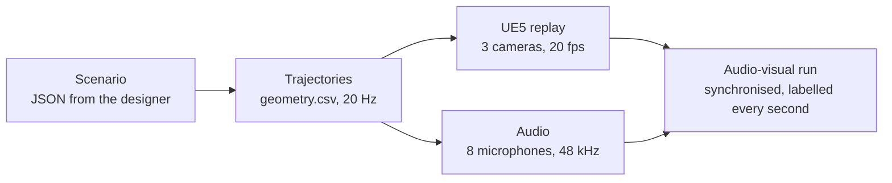
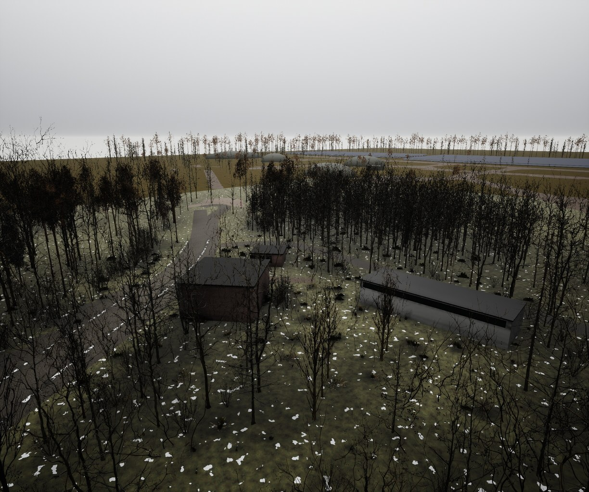
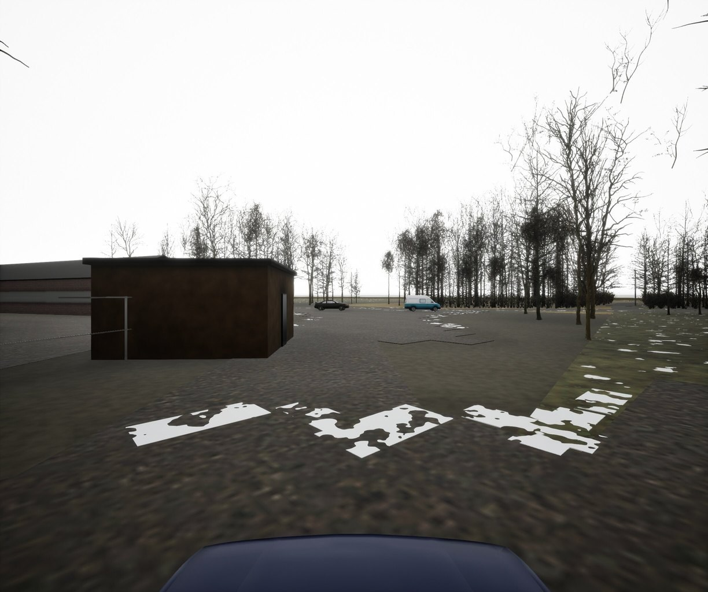
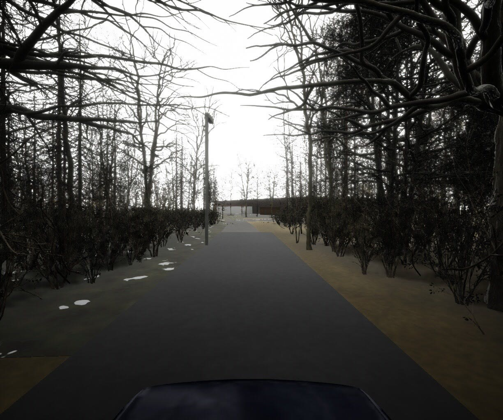
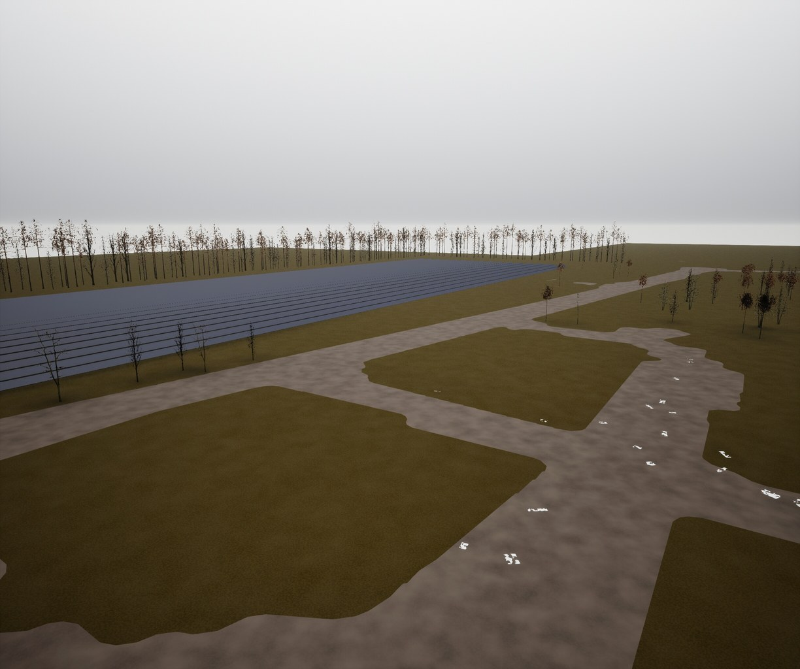
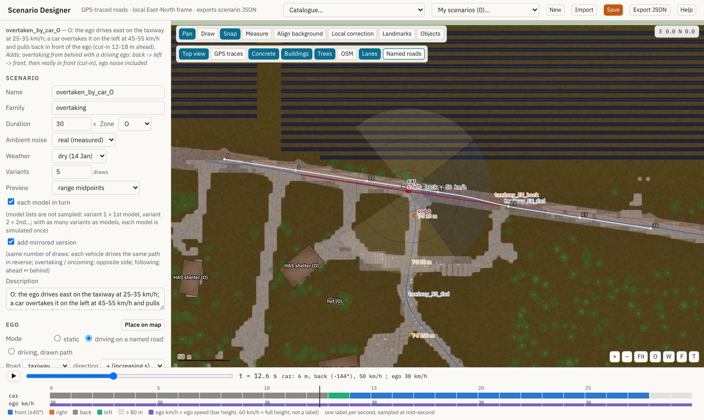

# AV_Environment-UE5: an Unreal Engine 5 environment for audio-visual vehicle perception

**Katerina Vinciguerra**

[](https://doi.org/10.5281/zenodo.23749372)


https://github.com/user-attachments/assets/aba2d46f-4043-4d9f-a513-56129dc8e820

*The three cameras of the ego vehicle (left, front, right) in the hedge environment, with the simulated sound of the microphone array
(stereo mix): a car and a van cross behind the hedge. Play it with the sound on.*

## Overview

The environment reproduces a real test site where vehicles were recorded with a microphone array and three cameras. New scenarios are
drawn on the map, turned into 20 Hz trajectories and rendered in UE5; the sound comes from the companion audio dataset.



This repository holds the Unreal Engine project (level, materials, site meshes, sensors), the scenario designer and the scripts that
build the vehicles and render the cameras of a run. The trajectories and the audio of the runs come with the companion dataset; any
trajectory written in the same format can be rendered ([`docs/RENDERING.md`](docs/RENDERING.md), section 1).

## Environments

<table>
  <tr>
    <td width="50%"><br><b>W</b>: road along a hedge</td>
    <td width="50%"><br><b>F</b>: junction, seen from the ego vehicle</td>
  </tr>
  <tr>
    <td width="50%"><br><b>T</b>: track through a thicket</td>
    <td width="50%"><br><b>O</b>: concrete taxiway and T-junction</td>
  </tr>
</table>

## Scenario designer



*A car overtakes the ego vehicle on the taxiway: paths on the map of the site, distance and direction at time t, and the label of every
second below.*

- Paths snap to the lanes measured with GPS on the site; speeds per segment, static or driving ego vehicle.
- Direction labels (front, left, right, back) checked second by second before anything is rendered.
- 17 preset scenarios: pass-by, junction, overtaking, oncoming traffic, following. Export as JSON.
- A single web page that runs in any browser, offline: open [`designer/index.html`](designer/index.html) after downloading the repository.

## Sensors and frames

| | specification |
|---|---|
| world frame | East-North-Up in metres, anchored on a WGS84 point; in UE5, X = East, Y = −North, Z up (cm) |
| cameras | 3 (left, front, right), 1224 × 1024, horizontal FOV 91.09°, 20 fps, 1.99 m |
| microphones | 8-channel array, centre 1.90 m above the ground, 48 kHz |

The level holds the cameras and the microphones of the ego vehicle at the parking position of each zone (World Outliner folder
`Sensors`). Full rendering specification (coordinates, camera rig, exposure, sky, vehicles, outputs, audio alignment):
[`docs/RENDERING.md`](docs/RENDERING.md).

## Repository

```
AV_Environment-UE5/
├── AV_Environment.uproject  Unreal Engine 5.8 project (Blueprint only, no C++)
├── Config/                  rendering settings: Lumen, virtual shadow maps, ray tracing, DirectX 12 SM6
├── Content/
│   ├── Maps/Site.umap       the level: four environments in one GPS-aligned map, with the sensors
│   ├── Site/Scene/          buildings, roads and ground of the site
│   └── SiteSim/             materials, ground surfaces, sky, CC BY vehicles (police car, ambulance)
├── replay/
│   ├── build_vehicles.py    builds the vehicle meshes, textures and materials from the Fab packs (once)
│   ├── render_cameras.py    renders the three cameras of runs (videos, 1 fps images, frame index, overview)
│   ├── render_config.example.json
│   └── add_sensor_rigs.py   places the cameras and microphones of the ego vehicle in the level
├── examples/NEW/            two runs (geometry.csv + scene.json): zone W with a closed barrier, zone O with a driving ego
├── designer/index.html      scenario designer, a single web page
├── docs/RENDERING.md        frames, camera rig, exposure, sky, vehicles, outputs
├── media/                   images and videos of this page
├── LICENSE                  MIT (code) and CC BY 4.0 (scene, documentation)
└── CITATION.cff
```

## Installation

1. **Install Unreal Engine 5.8.** Windows and macOS: Epic Games Launcher → *Unreal Engine* → *Library* → *+* next to *Engine Versions* →
   5.8 → *Install*. Linux: download the Linux build from the Unreal Engine website, or build it from source.
2. **Get the repository.**
   ```
   git clone https://github.com/kate-vinci/AV_Environment-UE5.git
   ```
   or *Code → Download ZIP* on this page.
3. **Add the Fab content** listed below (all free). On fab.com, add each item to your library, then: packs → Epic Games Launcher →
   *Fab Library* → *Add to Project* → `AV_Environment`; Megascans and Megaplants → in the editor, *Window → Fab* (or the *Fab* button
   of the Content Drawer) → *My Library* → *+* on the item, with the Megascans quality tier left on *Medium* (the default). Keep the
   default folders: the level finds them there. The van is a plain download: put `003.obj` and
   `Base_Texture.png` of its OBJ format into `SourceArt/Standard_Delivery_Van/` (create the folder next to `AV_Environment.uproject`).

   | Fab content | items used by the level | lands in |
   |---|---|---|
   | Quixel Megaplants | Baltic Pine, Black Alder, Black Poplar, Goat Willow, Hornbeam, Norway Spruce | `Content/Megaplant_Library` |
   | Megascans plants | Dry Grass `tbbqejqr`, Thatching Grass `uddmcgbia`, Wild Grass `vczndjqja` | `Content/Fab/Megascans/Plants` |
   | Megascans surfaces | Road Asphalt `rh0ribp0`, Gravel Ground `xbnfagf`, Brick Wall `wgukbfj` | `Content/Fab/Megascans/Surfaces` |
   | Vehicle Variety Pack (Switchboard Studios) | hatchback (base of the three cars) | `Content/VehicleVarietyPack` |
   | Motorcycle Photoscan LOWPOLY | motorcycle | `Content/Fab/Motorcycle_Photoscan_LOWPOLY` |
   | Standard Delivery Van (Slowpoly) | base of the two vans (OBJ format) | `SourceArt/Standard_Delivery_Van` |

4. **Open the project.** Double-click `AV_Environment.uproject` (or *Launcher → Library → Browse*). There is no C++ code, so nothing to
   compile. The first opening compiles the shaders, which takes a while; the level opens by itself.
5. **Build the vehicles** (once). In the editor: *Tools → Execute Python Script…* → `replay/build_vehicles.py`. In about a minute it
   creates the cars, vans and motorcycle in `Content/SiteSim/Vehicules` from the Fab packs; the Output Log shows the progress and ends
   with `done`. The meshes are identical to the ones of the dataset renders.
6. **Render a run.** Copy `replay/render_config.example.json` to `replay/render_config.json` (it renders the runs of `examples/`), then
   *Tools → Execute Python Script…* → `replay/render_cameras.py`. Each run gets `cameras/cam0.mp4`, `cam1.mp4`, `cam2.mp4`,
   `frames_1fps.tar`, `frames_index.csv` and `overview_3cams.mp4`. It needs `ffmpeg` on the PATH. Another configuration file can be
   given in the Output Log (*Python* mode): `py "<full path>/replay/render_cameras.py" "<full path>/my_config.json"`. Details:
   [`docs/RENDERING.md`](docs/RENDERING.md).
7. **Draw a scenario.** Open `designer/index.html` in a browser, pick a preset in *Catalogue* or draw paths, then *Export JSON*.

## License and citation

Code (designer, replay scripts): MIT. Scene, materials, images, videos and documentation: CC BY 4.0. The Fab content keeps the license
of each pack and is not included in this repository. Vehicle models under CC BY 4.0: “Police car” by SpatialNeglect and “Ambulance” by
RCC Design (Fab), modified. Copyright © 2026 Katerina Vinciguerra.

If you use this environment, please cite:

```bibtex
@software{vinciguerra2026avenvironment,
  author    = {Katerina Vinciguerra},
  title     = {AV_Environment-UE5: an Unreal Engine 5 environment
               for audio-visual vehicle perception},
  year      = {2026},
  version   = {1.0.0},
  publisher = {Zenodo},
  doi       = {10.5281/zenodo.23749372},
  url       = {https://doi.org/10.5281/zenodo.23749372}
}
```
