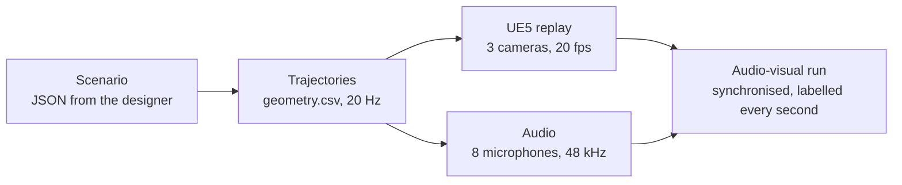

# AV_Environment-UE5: an Unreal Engine 5 environment for audio-visual vehicle perception

**Katerina Vinciguerra**


https://github.com/user-attachments/assets/aba2d46f-4043-4d9f-a513-56129dc8e820

*The three cameras of the ego vehicle (left, front, right) in the hedge environment, with the simulated sound of the microphone array
(stereo mix): a car and a van cross behind the hedge. Play it with the sound on.*

## Overview

The environment reproduces a real test site where vehicles were recorded with a microphone array and three cameras. New scenarios are
drawn on the map, turned into 20 Hz trajectories and rendered in UE5; the sound comes from the companion audio dataset.



> **Status.** The scenario designer and the rendering documentation are available now. The Unreal Engine project files (level, materials,
> site meshes) and the replay scripts are being prepared and will be added to this repository.

## Environments

<table>
  <tr>
    <td width="50%"><br><b>W</b>: road along a hedge</td>
    <td width="50%"><br><b>F</b>: junction, seen from the ego vehicle</td>
  </tr>
  <tr>
    <td width="50%"><br><b>T</b>: track through a thicket</td>
    <td width="50%"><br><b>O</b>: concrete taxiway and T-junction</td>
  </tr>
</table>

## Scenario designer


*A car overtakes the ego vehicle on the taxiway: paths on the map of the site, distance and direction at time t, and the label of every
second below.*

- Paths snap to the lanes measured with GPS on the site; speeds per segment, static or driving ego vehicle.
- Direction labels (front, left, right, back) checked second by second before anything is rendered.
- 17 preset scenarios: pass-by, junction, overtaking, oncoming traffic, following. Export as JSON.
- A single web page that runs in any browser, offline: open [`designer/index.html`](designer/index.html) after downloading the repository.

## Sensors and frames

| | specification |
|---|---|
| world frame | East-North-Up in metres, anchored on a WGS84 point; in UE5, X = East, Y = −North, Z up (cm) |
| cameras | 3 (left, front, right), 1224 × 1024, horizontal FOV 91.09°, 20 fps, 1.99 m |
| microphones | 8-channel array, centre 1.90 m above the ground, 48 kHz |

Full rendering specification (coordinates, camera rig, exposure, sky, vehicles, outputs, audio alignment):
[`docs/RENDERING.md`](docs/RENDERING.md).

## Repository

```
AV_Environment-UE5/
├── designer/index.html      scenario designer, a single web page
├── docs/RENDERING.md        frames, camera rig, exposure, sky, vehicles, outputs
├── media/                   images and videos of this page
├── LICENSE                  MIT (code) and CC BY 4.0 (scene, documentation)
├── CITATION.cff
│
│   to be added with the project files:
├── AV_Environment.uproject  Unreal Engine 5.8 project (Blueprint only, no C++)
├── Config/                  rendering settings: Lumen, virtual shadow maps, DirectX 12 SM6
├── Content/
│   ├── Maps/Site.umap       the level: four environments in one GPS-aligned map
│   ├── SiteSim/             materials, ground surfaces, sky, CC BY vehicles
│   └── Site/                buildings and site meshes
└── replay/
    ├── build_vehicles.py    builds the vehicle meshes from the Fab packs
    └── render_run.py        renders the three cameras of a run
```

## Installation

The scenario designer needs no installation: open `designer/index.html` in a browser. The steps below apply once the project files are
added.

1. **Install Unreal Engine 5.8.** Windows and macOS: Epic Games Launcher → *Unreal Engine* → *Library* → *+* next to *Engine Versions* →
   5.8 → *Install*. Linux: download the Linux build from the Unreal Engine website, or build it from source.
2. **Get the repository.**
   ```
   git clone https://github.com/kate-vinci/AV_Environment-UE5.git
   ```
   or *Code → Download ZIP* on this page.
3. **Add the Fab content** listed below. On fab.com, add each item to your library, then: packs → Epic Games Launcher → *Fab Library* →
   *Add to Project* → `AV_Environment`; Megascans → in the editor, *Window → Fab*, search the name, *Add to Project*. Keep the default
   folders: the level finds them there. The van is a plain download: unzip its OBJ format into `SourceArt/Standard_Delivery_Van`.

   | Fab content | items used by the level | lands in |
   |---|---|---|
   | Megaplant Library | Baltic Pine, Black Alder, Black Poplar, Goat Willow, Hornbeam, Norway Spruce, Aleppo Pine | `Content/Megaplant_Library` |
   | Megascans plants | Dry Grass `tbbqejqr`, Thatching Grass `uddmcgbia`, Wild Grass `vczndjqja` | `Content/Fab/Megascans/Plants` |
   | Megascans surfaces | Road Asphalt `rh0ribp0`, Gravel Ground `xbnfagf`, Brick Wall `wgukbfj` | `Content/Fab/Megascans/Surfaces` |
   | Vehicle Variety Pack | hatchback (base of the three cars) | `Content/VehicleVarietyPack` |
   | Standard Delivery Van (Slowpoly) | base of the two vans (OBJ download) | `SourceArt/Standard_Delivery_Van` |
   | Motorcycle Photoscan LOWPOLY | motorcycle | `Content/Fab/Motorcycle_Photoscan_LOWPOLY` |

4. **Open the project.** Double-click `AV_Environment.uproject` (or *Launcher → Library → Browse*). There is no C++ code, so nothing to
   compile. The first opening compiles the shaders, which takes a while; the level opens by itself.
5. **Build the vehicles** (once). In the editor: *Tools → Execute Python Script…* → `replay/build_vehicles.py`. It creates the cars, vans
   and motorcycle in `Content/SiteSim/Vehicles` from the Fab packs.
6. **Draw a scenario.** Open `designer/index.html` in a browser, pick a preset in *Catalogue* or draw paths, then *Export JSON*.
7. **Render a run.** In the editor, *Output Log*, switch the input from *Cmd* to *Python*:
   ```
   py "replay/render_run.py" --run "path/to/run" --cameras 0,1,2
   ```
   The frames go to `path/to/run/cameras/`; `ffmpeg` on the PATH encodes them to MP4 at 20 fps. Details:
   [`docs/RENDERING.md`](docs/RENDERING.md).

## License and citation

Code (designer, replay scripts): MIT. Scene, materials, images, videos and documentation: CC BY 4.0. The Fab content keeps the license
of each pack and is not included in this repository. Vehicle models under CC BY 4.0: “Police car” by SpatialNeglect and “Ambulance” by
RCC Design (Fab), modified. Copyright © 2026 Katerina Vinciguerra.

If you use this environment, please cite:

```bibtex
@misc{vinciguerra2026avenvironment,
  author       = {Katerina Vinciguerra},
  title        = {AV_Environment-UE5: an Unreal Engine 5 environment
                  for audio-visual vehicle perception},
  year         = {2026},
  howpublished = {\url{https://github.com/kate-vinci/AV_Environment-UE5}}
}
```
